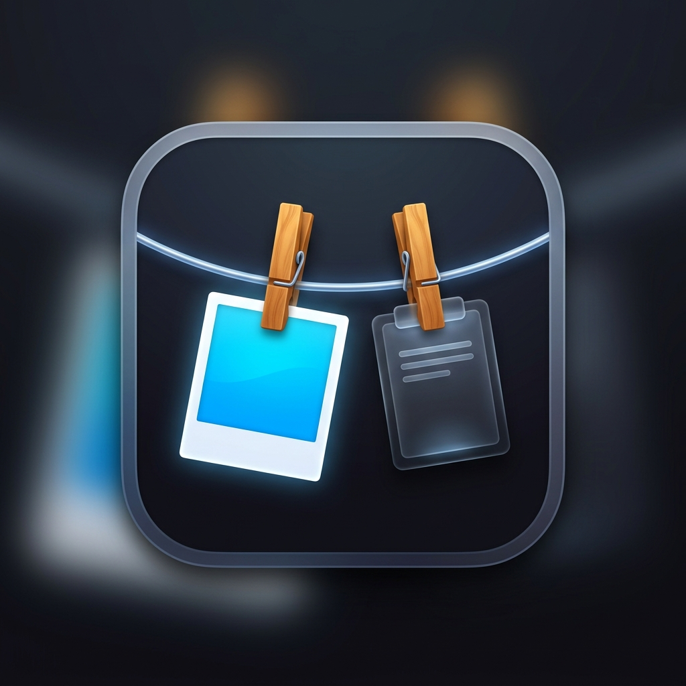

<p align="center">
  
</p>

# Clothey ⚡🧺

**Clothey** adalah aplikasi desktop Windows native yang ultra-ringan, cepat, dan efisien yang dibangun menggunakan **C# .NET 8 WPF** (`net8.0-windows10.0.19041.0`). Mengusung estetika **Apple macOS / MacBook Minimalist** (obsidian frosted glass, macOS traffic light controls, Dynamic Island pills, dan kartu jemuran interaktif).

Aplikasi ini berjalan senyap di background tray dengan performa **60 FPS**, konsumsi RAM sangat rendah (**~16 MB saat standby**, batas <50 MB), dan **zero CPU usage** saat idle.

### ✨ Fitur Terbaru
- **Auto-Hide Top Edge (Default):** Jemuran otomatis tersembunyi ke tepi atas layar dan muncul halus saat kursor menyentuh tepi atas layar (bisa di-toggle ke *Always Visible* di System Tray).
- **Auto-Pin Copy Text (`Ctrl+C`):** Teks yang disalin otomatis digantung sebagai kartu dark-glass dengan badge kategori pintar (`COLOR` + swatch, `URL`, `CODE`, `CLIP`), filter anti-duplikat, batas maksimal 10 kartu, dan klik kartu untuk copy ulang.
- **Preview Annotation Toolbar:** Toolbar melayang di Quick Look untuk mencoret (**Pencil**, **Line**, **Rectangle**, **Eraser**, **5 Warna**, **S/M/L**, **Undo `Ctrl+Z`**) yang langsung ter-flatten ke gambar resolusi penuh saat **Copy Image** / **Save As**.

---

## 📸 Fitur Utama & Mekanisme

### 1. Low-Level Keyboard Hook (Tombol `F1` Instan 0ms)
- Menggunakan Win32 API (`SetWindowsHookEx` dengan `WH_KEYBOARD_LL`).
- **Instant Trigger (0ms Latency)**: Menekan tombol `F1` langsung memicu seleksi area (*Snipping Area Capture*) seketika tanpa jeda timer.
- Unhook bersih pada `Application.Exit` (`UnhookWindowsHookEx`) sehingga tidak menimbulkan input lag pada sistem operasi.
- Opsi toggle aktif/nonaktif hotkey melalui System Tray menu.

### 2. Clothesline UI (Tali Fisika Lentur & Multi-Monitor)
- **Desain Tali Mandiri Per Monitor**: Setiap monitor (Monitor 1, Monitor 2, dst.) memiliki bentangan tali jemurannya sendiri yang terpasang rapi di batas atas masing-masing layar tanpa kabel diagonal yang memotong antar monitor.
- **Tali Lentur Elastis (*Elastic Catenary Curve*)**: Tali memiliki kelengkungan kurva gravitasi alami (*Quadratic Bezier curve*) dan membal elastis (*spring bounce*) saat kartu baru menempel atau digeser.
- **Pin Magnetik Presisi 1:1**: Pin magnetik *Space Gray* dengan *specular center dot* terpasang tepat mencubit tali jemuran (tidak ada celah melayang).
- **Anti-Blocking Pojok Kanan**: Tombol kontrol dan Clear diletakkan di sisi kiri atas, membiarkan pojok kanan atas 100% bebas klik untuk tombol close (`✕`) aplikasi lain.
- **Bebas Kedip (Zero Flicker Hover)**: Hover card mengaktifkan aksen border glow halus Apple System Blue (`#0A84FF`) dan soft ambient shadow tanpa menggeser hit-box koordinat kartu.
- **Smooth Drag & Native File Drop**:
  - Geser kartu ke samping di sepanjang lengkungan tali dengan pelacakan kursor instan 1:1.
  - Tarik kartu ke bawah (>130px) untuk langsung drag-and-drop file gambar ke Discord, WhatsApp Desktop/Web, VS Code, Browser, atau File Explorer.

### 3. Apple macOS Quick Look Preview (Modal Interaktif 8-Way Resize)
- **Estetika macOS Sequoia / CleanShot X**:
  - Latar belakang *Obsidian Frosted Glass* (`#18181B`) dengan sudut *Squircle* (`CornerRadius 16px`).
  - **macOS Traffic Light Titlebar**:
    - 🔴 **Merah (`#FF5F56`)**: Menutup preview (bisa juga via tombol **Esc** atau **Spasi**).
    - 🟡 **Kuning (`#FFBD2E`)**: Minimize window.
    - 🟢 **Hijau (`#27C93F`)**: Maximize / Restore window.
- **8-Way Window Resizing**:
  - Menggunakan native Win32 `WM_NCHITTEST` handler.
  - Kursor mouse otomatis berubah menjadi panah resize di seluruh 4 sisi dan 4 sudut window.
  - Ukuran window dapat diperkecil atau diperbesar bebas dengan snapping responsif.
- **Interactive Viewport (Zoom & Pan)**:
  - Scroll mouse wheel untuk zoom in/out (20% – 500%).
  - Klik kiri + geser untuk panning saat gambar di-zoom.
  - Double-click untuk toggle zoom 100% / 200%.
  - *Fant / High-Quality Scaling* untuk tampilan piksel kristal HD.
- **Dynamic Island Action Pill**:
  - Pil aksi melayang di bagian bawah: **Copy Image** (`Ctrl+C`), **Save As** (`Ctrl+S`), **Live Text (OCR)**, dan **Open in Default Viewer**.
  - Notifikasi toast halus di dalam window tanpa dialog pop-up `MessageBox` kuno.

### 4. Screen Capture & OCR Engine 1:1 HD
- Menggunakan `System.Drawing.Graphics.CopyFromScreen` dengan manifes `PerMonitorV2` High-DPI dan Win32 `SetProcessDpiAwarenessContext`.
- Mengambil piksel fisik murni tanpa *DWM stretching blur*, menjamin teks dan gambar screenshot selalu tajam.
- Layanan OCR terintegrasi menggunakan engine bawaan Windows 10/11 (`Windows.Media.Ocr.OcrEngine`).

---

## 🛠️ Struktur Proyek

```text
Clothey/
├── PegSnap.sln
├── run.bat
├── assets/
│   └── clothey_icon.png
├── src/
│   └── PegSnap/
│       ├── App.xaml / App.xaml.cs
│       ├── PegSnap.csproj           # AssemblyName: Clothey
│       ├── app.ico
│       ├── app.manifest             # PerMonitorV2 High DPI Awareness
│       ├── Core/
│       │   ├── Win32/NativeMethods.cs
│       │   ├── Hooks/KeyboardHookManager.cs
│       │   ├── Physics/DampedHarmonicOscillator.cs
│       │   ├── Radial/RadialMenuEngine.cs
│       │   ├── Capture/CaptureHelper.cs
│       │   └── Ocr/OcrService.cs
│       └── UI/
│           ├── Clothesline/ClotheslineWindow.xaml (.cs)
│           ├── Clothesline/PolaroidCardControl.xaml (.cs)
│           ├── Clothesline/TextCardControl.xaml (.cs)
│           ├── Snipping/SnippingWindow.xaml (.cs)
│           ├── Preview/PreviewWindow.xaml (.cs)
│           └── Tray/TrayIconManager.cs
└── tests/
    └── PegSnap.Tests/
```

---

## 🚀 Cara Menjalankan & Build

### 1. Langsung Pakai (Tanpa Install .NET SDK)
Download `Clothey.exe` dari halaman [**Releases**](https://github.com/DollllllllllllChan/Clothey/releases), lalu klik dua kali untuk langsung menjalankannya di System Tray.

### 2. Build dari Source (.NET 8 SDK)
```cmd
dotnet build src\PegSnap\PegSnap.csproj -c Release
dotnet publish src\PegSnap\PegSnap.csproj -c Release -r win-x64 --self-contained false -p:PublishSingleFile=true -o publish
```
Lalu jalankan `.\run.bat` atau `publish\Clothey.exe`.

---

## 📊 Hasil Verifikasi Runtime

- **Konsumsi RAM Standby**: **~16.2 MB** (sangat jauh di bawah batas <50 MB).
- **CPU Idle**: **0.0%**.
- **FPS**: 60–144 FPS smooth render dengan hardware acceleration.
- **Window Resize**: 8-way resize border/corner aktif pada Quick Look modal preview.
- **Multi-Monitor**: Tali mandiri per monitor tanpa artefak diagonal.
